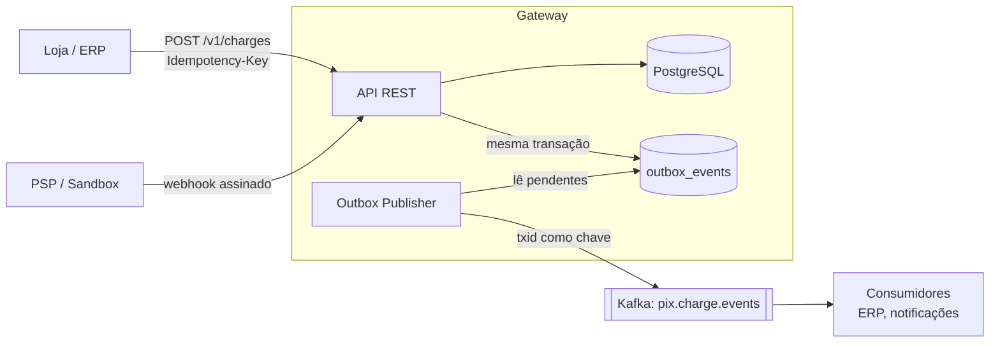
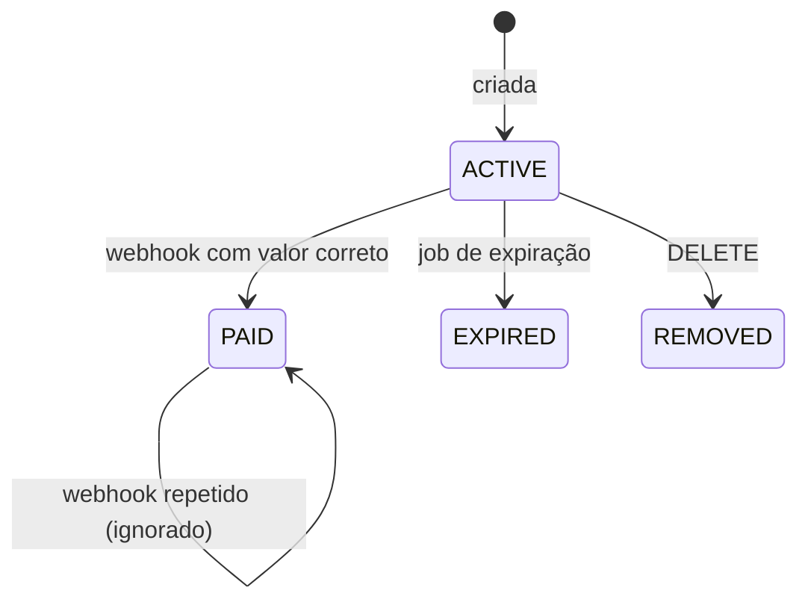

# Pix Payment Gateway

[](https://github.com/efvieira/pix-payment-gateway/actions/workflows/ci.yml)
[](https://github.com/efvieira/pix-payment-gateway/actions/workflows/cd.yml)


[](LICENSE)

Gateway de pagamentos **Pix simulado**: cria cobranças com QR Code (BR Code), recebe a confirmação do PSP por webhook, publica eventos de forma confiável e concilia o extrato do dia.

Tudo foi construído a partir das especificações públicas do Banco Central (Manual de Padrões para Iniciação do Pix e API Pix). Nenhum dado real de PSP é usado.

### ✨ Destaques

- 🔁 **Idempotência** na criação de cobranças (`Idempotency-Key`), com a resposta original devolvida nas retentativas
- 📤 **Transactional outbox** + Kafka: o evento é gravado na mesma transação da mudança de estado
- ⏱️ **Retentativas com backoff exponencial** e fila de falhas com reprocessamento manual
- 🔐 **Webhook assinado** com HMAC-SHA256 e processamento idempotente pelo `endToEndId`
- 🧾 **BR Code (Pix Copia e Cola)** no padrão EMV, com CRC16 validado em teste
- ⚖️ **Conciliação** do extrato do PSP com os pagamentos registrados
- 🧵 **Java 25**: records, sealed interfaces, pattern matching em `switch` e virtual threads
- 🧪 Testes unitários e de integração com cobertura mínima exigida no build (JaCoCo)

### 🛠️ Stack

Java 25 · Spring Boot 4.1 · Spring Data JPA · Flyway · PostgreSQL · Apache Kafka · springdoc-openapi · JUnit 5 · Mockito · JaCoCo · Docker · GitHub Actions

## 🏗️ Arquitetura



### Ciclo de vida da cobrança



## 🧠 Decisões técnicas

| Decisão | Por quê |
|---|---|
| Outbox em vez de publicar direto no Kafka | Publicar dentro da transação causa *dual write*: o banco pode confirmar e o Kafka falhar (ou o contrário). Com o outbox, o evento só existe se a mudança foi confirmada. |
| Chave da mensagem = `txid` | Garante ordem dos eventos de uma mesma cobrança dentro da partição. |
| Entrega *at-least-once* | Mais simples e robusta que *exactly-once*. Os consumidores tratam duplicatas pelo id do evento. |
| Idempotência gravada na mesma transação da cobrança | Se a operação falhar, a chave não fica "queimada". Requisições concorrentes com a mesma chave caem na PK e recebem `409`. |
| `PaymentOutcome` como *sealed interface* | O compilador obriga a tratar todos os resultados (`Confirmed`, `Duplicate`, `Rejected`) no `switch`. |
| HMAC no corpo bruto | Validar o JSON já desserializado permitiria aceitar um corpo diferente do que foi assinado. |
| Valor divergente gera `pix.payment.rejected` | O dinheiro já entrou; o evento permite acionar devolução em vez de perder a informação. |

## 🚀 Como rodar

Pré-requisito: Docker.

```bash
docker compose up -d --build
```

| Serviço | URL |
|---|---|
| Swagger | http://localhost:8080/swagger-ui.html |
| Kafka UI | http://localhost:8090 |
| Health | http://localhost:8080/actuator/health |

### Fluxo de exemplo

```bash
# 1. Criar a cobrança
curl -s -X POST localhost:8080/v1/charges \
  -H 'Content-Type: application/json' -H 'Idempotency-Key: pedido-123' \
  -d '{"amount": 49.90, "description": "Pedido 123"}'

# 2. Simular o pagamento pelo PSP (sandbox)
curl -s -X POST localhost:8080/v1/sandbox/charges/<txid>/pay

# 3. Consultar
curl -s localhost:8080/v1/charges/<txid>

# 4. Ver a saúde do outbox
curl -s localhost:8080/v1/admin/outbox/stats
```

### Rodar os testes

```bash
./mvnw verify
```

## 📡 Endpoints

| Método | Rota | Descrição |
|---|---|---|
| `POST` | `/v1/charges` | Cria cobrança (exige `Idempotency-Key`) |
| `GET` | `/v1/charges/{txid}` | Consulta cobrança |
| `DELETE` | `/v1/charges/{txid}` | Remove cobrança ativa |
| `POST` | `/v1/webhooks/pix` | Recebe notificação do PSP (`X-Pix-Signature`) |
| `POST` | `/v1/sandbox/charges/{txid}/pay` | Simula pagamento (só com `pix.sandbox.enabled=true`) |
| `POST` | `/v1/reconciliation` | Concilia o extrato de um dia |
| `GET` | `/v1/admin/outbox/stats` | Eventos por status |
| `GET` | `/v1/admin/outbox/failed` | Eventos que esgotaram as tentativas |
| `POST` | `/v1/admin/outbox/{id}/retry` | Reprocessa um evento com falha |

## 🔀 Fluxo de branches e CI/CD

`develop` (padrão) → `release` → `master`. Detalhes em [CONTRIBUTING.md](CONTRIBUTING.md).

- **CI** em todo push e PR: build, testes e verificação de cobertura com Java 25.
- **CD** em `release` publica a imagem `ghcr.io/efvieira/pix-payment-gateway:rc`; em `master`, a `:latest` e uma release no GitHub.

## 🗺️ Próximos passos

- [ ] Autenticação mTLS + OAuth2 client credentials, como na API Pix real
- [ ] Devolução (`/pix/{e2eid}/devolucao`)
- [ ] Testcontainers para Postgres e Kafka nos testes de integração
- [ ] Integração com o [pos-fiscal-nfce](https://github.com/efvieira/pos-fiscal-nfce) para receber Pix no caixa

## 📄 Licença

[MIT](LICENSE)
